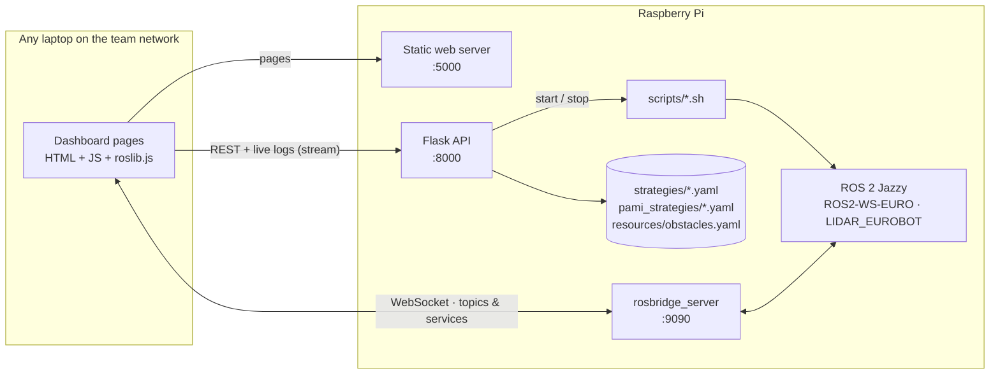

# Eurobot Dashboard

The web control room for AEROBOTIX INSAT's EUROBOT 2026 robot. It runs **on the robot's Raspberry Pi**, and anyone on the team network can open it from a laptop to:

- write and pick match strategies for the main robot and the PAMIs,
- prepare the robot (start the planner, lidar, and rosbridge) and launch or stop a match,
- watch the robot live on the table: position, planned path, obstacles, and opponent,
- test each mechanism and planner service on its own.

It talks to ROS 2 in two ways: a small **Flask API** that edits files and starts or stops processes, and **rosbridge** for live topics and services straight from the browser.

## Architecture



## Pages

| Page | What it is for |
|---|---|
| **Home** (`index.html`) | Match control: *Prepare Robot*, *Start Strategy*, *Stop Strategy*, *Restart MicroROS*, and the live log of each process |
| **Strategy** (`strategy_selector.html`, `strategy_viewer.html`) | Create, rename, delete, and select main-robot strategies, and preview their paths on the table |
| **PAMI strategies** (`pami_strategy_selector.html`, `pami_strategy_viewer.html`) | Same for the PAMI robots, one sequence per PAMI number |
| **Pathfinding** (`pathfinding_simulation.html`) | Place start, goal, opponent, and game elements, then ask the Hybrid A* planner for a path |
| **Real-Time** (`realtime_robot.html`) | Live robot pose, planned path, obstacles, and opponent on a map oriented like the real table; choose a blue or yellow strategy and start it |
| **TEST** (`test_controller.html`) | Send single commands to the front/back mechanisms (`n20`, `kabech`, `dawer`, pump), call planner services (update, clear, test map), reset the beacon, and run PAMI tests |

The ⚙️ button sets the Pi's IP address. When you open the dashboard from the Pi's own address, it is detected automatically; the setting is saved in the browser.

## ROS 2 interface (via rosbridge)

The browser uses [roslib.js](https://github.com/RobotWebTools/roslibjs) (bundled in `js/lib/`) to connect to `ws://<pi-ip>:9090`.

| Topic / service | Type | Direction | Use |
|---|---|---|---|
| `/robot_pose_raw` | `geometry_msgs/Vector3` | subscribe | Robot pose from the STM32 |
| `/path_visualization` | `visualization_msgs/MarkerArray` | subscribe | Planned path |
| `/obstacles/current` | `hybrid_astar/ObstacleArray` | subscribe | Game elements and obstacles on the map |
| `/obstacle_relative`, `/obstacle_relative_speed` | `PoseStamped`, `Twist` | subscribe | Opponent seen by the lidar |
| `/web/start_pose`, `/web/goal_pose`, `/web/enemy_pose`, `/web/compute_path`, `/web/send_batches`, `/web/steal_batch`, `/web/start_task_scheduler`, `/web/test_controller` | `std_msgs/String` (JSON) | publish | Commands to the `web_handler` node |
| `/web/path_result`, `/web/test_controller_result`, `/web/steal_batch_result`, `/web/start_task_scheduler_result`, `/web/task_scheduler_status` | `std_msgs/String` (JSON) | subscribe | Results and status |
| `/update_map` | `std_srvs/Trigger` | service call | Refresh the planner's map |

The ROS side of these topics is the `web_handler` node in [ROS2-WS-EURO](https://github.com/Eurobot-2026-Aerobotix/ROS2-WS-EURO/tree/main/src/hybrid_astar).

## HTTP API (Flask, port 8000)

| Endpoint | Purpose |
|---|---|
| `GET/POST/DELETE /strategies[/<file>]`, `GET /strategies/full` | Main-robot strategy files |
| `GET/POST/DELETE /pami_strategies[/...]` | PAMI strategy files |
| `GET /obstacles`, `POST/PUT/DELETE /obstacles/batch[/<id>]` | Fixed obstacles (`resources/obstacles.yaml`) |
| `GET/POST /web_batches` | Game elements used by the pathfinding simulation |
| `POST /prepare` | Run `scripts/prepare.sh`, then `scripts/pathfinding.sh` |
| `POST /start`, `POST /stop` | Start or stop `scripts/start.sh` (the `strategy_manager`) |
| `POST /test_pami` | Run `scripts/pami.sh` |
| `POST /restart_microros` | Restart the micro-ROS agents |
| `GET /stream/<source>` | Live log output (`strategy`, `pathfinding`, ...) |
| `GET /health` | Health check |

Several people can use the dashboard at once: file writes are locked, and log streams are broadcast to every open page.

## What the buttons run

| Button | Script | Starts |
|---|---|---|
| Prepare Robot | `scripts/prepare.sh` + `scripts/pathfinding.sh` | Stops leftovers, then starts `lidar_obstacle_warning robot_only.launch.py`, `rosbridge_websocket_launch.xml`, and `hybrid_astar.launch.py` |
| Start Strategy | `scripts/start.sh <strategy> <publish_pami>` | `ros2 run euro strategy_manager` with the selected strategy |
| Test PAMI | `scripts/pami.sh <strategy> <pami_numbers> <order>` | `ros2 run euro pami_test_manager` |
| Restart MicroROS | systemd | `eurobot-micro-ros-agents.service` |

`scripts/start_micro_ros_agents.sh` (run by that service) keeps one agent alive per board, restarting it if it exits:

| Agent | Transport | Board |
|---|---|---|
| `/dev/ttyACM0` | serial, 115200 baud | STM32 drive controller |
| `/dev/ESP1`, `/dev/ESP2`, `/dev/ESP3` | serial, 115200 baud | ESP32 front, back, and pneumatic boards |
| `10.42.1.1:8888` | UDP | PAMI robots over Wi-Fi |

Agent logs go to `/tmp/micro_ros_logs/`. The stable names `/dev/ESP1`-`/dev/ESP3` come from udev rules on the Pi, which are not stored in this repository.

## Strategy files

Main-robot strategies (`strategies/*.yaml`) use the task format described in [ROS2-WS-EURO](https://github.com/Eurobot-2026-Aerobotix/ROS2-WS-EURO#strategy-files). PAMI strategies (`pami_strategies/*.yaml`) are a list of numeric commands for one PAMI:

```yaml
strategy_name: pami_complete_blue
pami_number: 6
color: blue
order: 3
sequence:
- [3, 401.19, 2933.42, -180]   # command ID followed by its parameters
- [5, 85000]
- [1, 410.97, 2908.55, 380]
```

The command IDs are defined in [PAMI_ESP32_code](https://github.com/Eurobot-2026-Aerobotix/PAMI_ESP32_code).

## Install on the Raspberry Pi

Requirements: ROS 2 Jazzy, `ros-jazzy-rosbridge-suite`, `micro_ros_agent`, and these workspaces built in the home directory:

- `~/ROS2-WS-EURO` ([repo](https://github.com/Eurobot-2026-Aerobotix/ROS2-WS-EURO))
- `~/LIDAR_EUROBOT` ([repo](https://github.com/Eurobot-2026-Aerobotix/LIDAR_EUROBOT))

```bash
sudo apt install ros-jazzy-rosbridge-suite
git clone https://github.com/Eurobot-2026-Aerobotix/Eurobot_Dashboard.git ~/Eurobot_Dashboard
cd ~/Eurobot_Dashboard
pip3 install -r requirements.txt     # Flask, Flask-Cors, PyYAML
```

Run it once by hand:

```bash
python3 server.py      # web pages on :5000, API on :8000
```

Then open `http://<pi-ip>:5000` from any computer on the same network.

### Start on boot (systemd)

```bash
./install_service.sh                     # eurobot-dashboard.service
./install_micro_ros_agents_service.sh    # eurobot-micro-ros-agents.service
```

The unit files use the user `harissa` and the path `/home/harissa/Eurobot_Dashboard`. Edit `User=`, `WorkingDirectory=`, and `ExecStart=` if your setup is different.

```bash
journalctl -u eurobot-dashboard -f       # dashboard logs
```

## Repository layout

```text
server.py                 Flask API + static web server
html/                     pages
js/                       page logic, roslib.js, config
classes/                  Strategy, Task, Action, Pami_Strategy models
css/
strategies/               main-robot strategies (YAML)
pami_strategies/          PAMI strategies (YAML)
resources/                table map, logos, obstacles.yaml
scripts/                  prepare / start / pathfinding / pami / micro-ROS agents
*.service, install_*.sh   systemd setup
SETUP_RASPBERRY_PI.md     detailed Pi setup
IMPROVEMENTS.md           stability fixes log
```

## Security

The dashboard has no login and can start and stop robot processes. Use it only on the team's private network.
